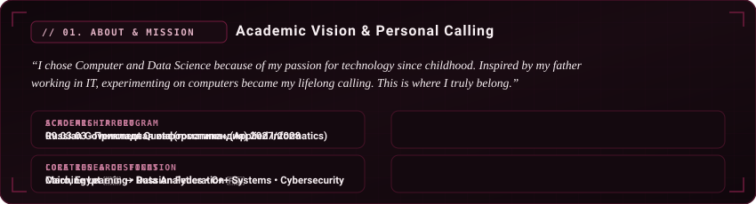
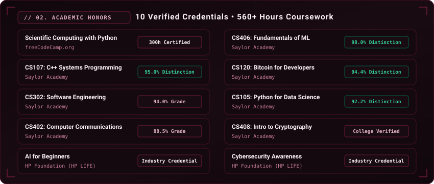
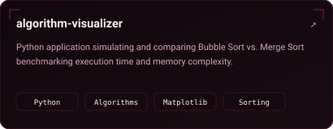
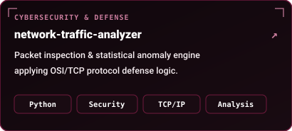
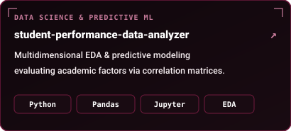
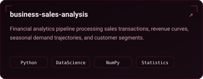
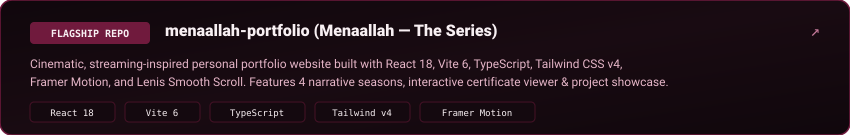
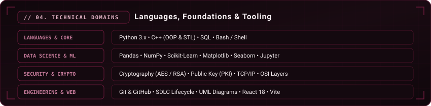

  <!-- 01. Animated Hero Banner (Rectangle 1) -->
  

    

  <!-- Action Badges (Rectangles Row) -->
  

    
    &nbsp;
    
    &nbsp;
    
  

   

  <!-- 02. About & Academic Mission (Rectangle 2) -->
  

    

  <!-- 03. 10 Verified Credentials & Honors (Rectangle 3) -->
  

    

  <!-- 04. Featured Code Projects (Rectangles Grid) -->
  <table width="100%" border="0" cellspacing="10" cellpadding="0">
    <tr>
      <td width="50%" align="center" valign="middle">
        
      </td>
      <td width="50%" align="center" valign="middle">
        
      </td>
    </tr>
    <tr>
      <td width="50%" align="center" valign="middle">
        
      </td>
      <td width="50%" align="center" valign="middle">
        
      </td>
    </tr>
    <tr>
      <td colspan="2" align="center" valign="middle">
        
      </td>
    </tr>
  </table>

   

  <!-- 05. Technical Domains & Repertoire (Rectangle 5) -->
  

    

  <!-- 06. GitHub Activity & Analytics (Rectangles Row) -->
  <table width="100%" border="0" cellspacing="10" cellpadding="0">
    <tr>
      <td width="52%" align="center" valign="middle">
        
      </td>
      <td width="48%" align="center" valign="middle">
        
      </td>
    </tr>
  </table>

   

  <!-- 07. Animated Footer Banner (Rectangle 7) -->
  

    

  <!-- Connect Links -->
  

    
    &nbsp;
    
    &nbsp;
    
  

