<div align="center">

  <!-- Animated Hero SVG Banner -->
  

  <br />

  <!-- Interactive Badges & Status -->
  <p align="center">
    <a href="https://github.com/mena827/menaallah-portfolio">
      
    </a>
    &nbsp;
    <a href="mailto:mennaallahtamer4@gmail.com">
      
    </a>
    &nbsp;
    
  </p>

</div>

---

### 👩‍💻 About Me & Academic Vision

> *“I chose Computer and Data Science because of my passion for technology since childhood. My father works in the tech field, and I grew up fascinated by everything he did. I spent my days exploring, experimenting on the computer, and turning complex questions into code. Out of all the fields in the world, this is where I belong.”*

* 🏛️ **Target:** Bachelor's Degree in **`09.03.03 Прикладная информатика` (Applied Informatics / Computer Science)** via the **Russian Government Scholarship (Quota 2027/2028)**.
* 🇷🇺 **Why Russia:** Deep academic heritage in mathematics, algorithmic problem-solving, and cutting-edge software engineering.
* 🔭 **Core Focus:** Foundations of **Data Science**, **Machine Learning**, **Low-Level Systems (C++)**, and **Cybersecurity & Cryptography**.
* 📍 **Location:** Cairo, Egypt 🇪🇬 ➔ Russian Federation 🇷🇺

---

### 🏆 10 Verified Credentials & Academic Honors

A solid foundation backed by **over 560+ hours** of university-level coursework and rigorous distinction exams:

| Credential / Course | Issuing Institution | Grade / Distinction | Academic Focus |
| :--- | :--- | :---: | :--- |
| **Scientific Computing with Python** | **freeCodeCamp.org** | **Certified (300 hrs)** | Algorithmic thinking, data structures & computing |
| **CS406: Fundamentals of Machine Learning** | **Saylor Academy** | **98.0% Distinction** | Supervised, unsupervised & neural model fundamentals |
| **CS107: C++ Systems Programming** | **Saylor Academy** | **95.0% Distinction** | Memory management, pointers, OOP & STL architecture |
| **CS120: Bitcoin for Developers I** | **Saylor Academy** | **94.4% Distinction** | Consensus algorithms, cryptographic hashing & ledgers |
| **CS302: Software Engineering** | **Saylor Academy** | **94.0% Grade** | SDLC lifecycle, UML diagrams, modular clean architecture |
| **CS105: Python for Data Science** | **Saylor Academy** | **92.2% Distinction** | EDA, Pandas, NumPy, statistical distributions |
| **CS402: Computer Communications & Networks**| **Saylor Academy** | **88.5% Grade** | OSI / TCP-IP protocols, packet routing & architectures |
| **CS408: Introduction to Cryptography** | **Saylor Academy** | **Course Completed** | Symmetric/asymmetric ciphers, RSA, AES & PKI |
| **Artificial Intelligence for Beginners** | **HP Foundation (HP LIFE)** | **Verified Credential** | Real-world AI applications, ethics & business context |
| **Introduction to Cybersecurity Awareness** | **HP Foundation (HP LIFE)** | **Verified Credential** | Threat modeling, network defense & authentication |

---

### 🚀 Featured Code Repositories

<table width="100%">
  <tr>
    <td width="50%" valign="top">
      <h4>🔍 <a href="https://github.com/mena827/algorithm-visualizer">algorithm-visualizer</a></h4>
      <p>A Python application designed to visually simulate and benchmark sorting algorithms (Bubble Sort vs. Merge Sort), comparing time complexity and memory usage across varying dataset scales.</p>
      <code>Python</code> • <code>Algorithms</code> • <code>Sorting</code> • <code>Matplotlib</code>
    </td>
    <td width="50%" valign="top">
      <h4>🛡️ <a href="https://github.com/mena827/network-traffic-analyzer">network-traffic-analyzer</a></h4>
      <p>Network analysis tool for packet inspection and statistical anomaly flagging using synthetic data streams, applying OSI/TCP protocol principles and threat mitigation logic.</p>
      <code>Python</code> • <code>Cybersecurity</code> • <code>TCP/IP</code> • <code>Data Parsing</code>
    </td>
  </tr>
  <tr>
    <td width="50%" valign="top">
      <h4>📊 <a href="https://github.com/mena827/student-performance-data-analyzer">student-performance-data-analyzer</a></h4>
      <p>Exploratory Data Analysis (EDA) and predictive insight notebook modeling multidimensional factors influencing academic success with distribution charts and correlation matrices.</p>
      <code>Python</code> • <code>Pandas</code> • <code>NumPy</code> • <code>Jupyter</code> • <code>EDA</code>
    </td>
    <td width="50%" valign="top">
      <h4>📈 <a href="https://github.com/mena827/business-sales-analysis">business-sales-analysis</a></h4>
      <p>Business analytics pipeline processing financial transaction data, revenue trajectories, seasonal demand metrics, and customer segmentation indicators.</p>
      <code>Python</code> • <code>Data Science</code> • <code>Statistical Modeling</code>
    </td>
  </tr>
  <tr>
    <td colspan="2" valign="top">
      <h4>🎬 <a href="https://github.com/mena827/menaallah-portfolio">menaallah-portfolio (Menaallah — The Series)</a></h4>
      <p>Cinematic, streaming-inspired personal portfolio website built with React 18, Vite 6, TypeScript, Tailwind CSS v4, Framer Motion, and Lenis Smooth Scroll. Features 4 narrative seasons, interactive certificate viewer, and project showcases.</p>
      <code>React 18</code> • <code>Vite 6</code> • <code>TypeScript</code> • <code>Tailwind v4</code> • <code>Framer Motion</code> • <code>Lenis</code>
    </td>
  </tr>
</table>

---

### 🛠️ Technical Repertoire

```text
Languages & Core : Python 3.x, C++ (OOP & STL), SQL, Bash / Shell
Data Science & ML: Pandas, NumPy, Scikit-Learn, Matplotlib, Seaborn, Jupyter Notebooks
Security & Crypto: Cryptographic Primitives (AES/RSA), PKI, TCP/IP, OSI Layers, Threat Modeling
Engineering & Ops: Git, GitHub, Software Engineering Lifecycle (SDLC), UML Design
Web Technologies : React, Vite, TypeScript, Modern HTML5 & CSS3
Languages Spoken : Arabic (Native), English (Fluent / Technical), Russian (Learning for Quota)
```

---

### 📊 GitHub Activity & Analytics

<div align="center">
  
  &nbsp;
  
</div>

<br />

---

### 📬 Connect & Collaborate

<div align="center">

  <a href="mailto:mennaallahtamer4@gmail.com">
    
  </a>
  &nbsp;
  <a href="https://github.com/mena827">
    
  </a>
  &nbsp;
  <a href="https://github.com/mena827/menaallah-portfolio">
    
  </a>

  <br /><br />

  <!-- Animated Footer SVG Banner -->
  

</div>
